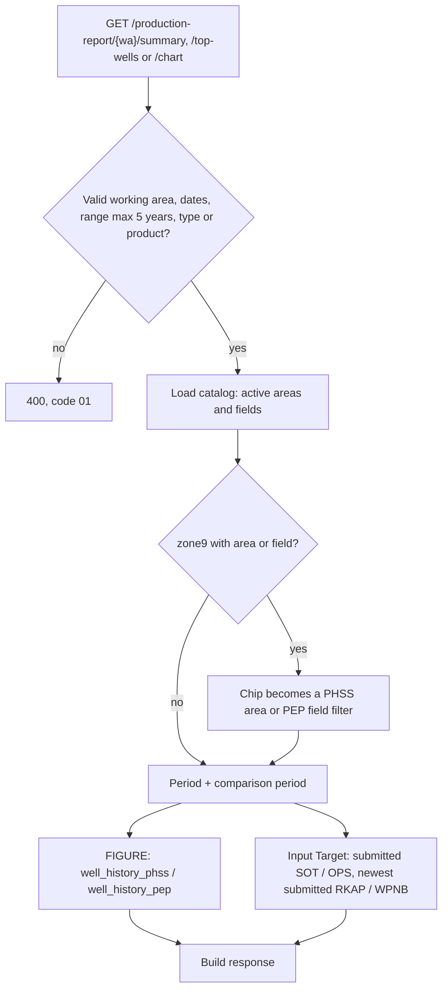
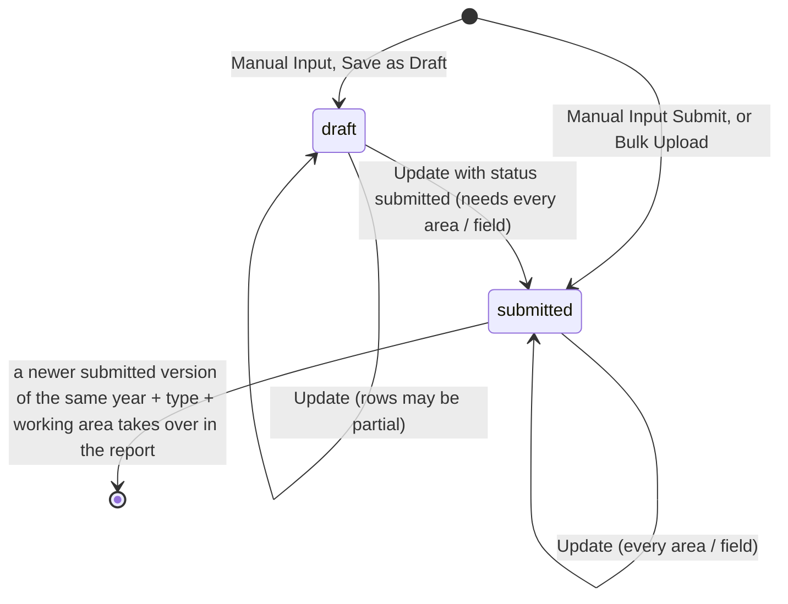
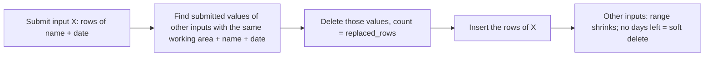

# Production Report: Knowledge

One file for all Production Report knowledge: the PRD, the FE contract, the data sources, the formulas, the Input Target rules, the design notes, the access rules, and the gaps.
**Rule:** when new knowledge comes in, update the section it belongs to **and** §1 Gaps (add a new gap, or move an answered one to `01-Decision-Log.md`).

## Contents
- §1. Gaps: open questions and open decisions
- §2. PRD summary (what each ticket asks)
- §3. FE contract and Bruno collection
- §4. Data sources and master data
- §5. Formulas: period, summary, Top 10, chart
- §6. Input Target rules (RKAP / WPNB, SOT / OPS)
- §7. Figma and design notes
- §8. Flows (Mermaid)
- §9. Access
- §10. References (all links)

Words: see the word list at the top of `01-Decision-Log.md`.

---

## 1. Gaps: open questions and open decisions

25 Nov 2026. Only **open** points. Each has the question, why we ask, and our proposal if we have one. Answered points are in `01-Decision-Log.md`.

### A. Input Target rules

**G1. Can every RKAP / WPNB line be edited, or only the newest version?**
- **Why we ask:** the Product Owner said on 19 Nov "only the newest version can be edited" (D19). The code lets every line be edited and the response has no `version` / `is_latest` (D23, user 22 Nov). The user asked the Product Owner to write the Q&A into the PRD, so QA will test this rule.
- **Proposal:** follow the PRD when it is written. If "newest only" stays: add `version` and `is_latest` to the list / detail response and return 400 on `POST /rkap-wpnb/{id}/update` for an older version.

**G2. Who can edit Input Target: by department only, or also by position?**
- **Why we ask:** the rule is "PO only, SM view" (D20). The code checks the department only:
  - View = the user's active departments include "Production Operations". A Senior Manager gets every department of the tree on GET, so the SM can view.
  - Edit = the user's own department is "Production Operations".
  - So a Manager in Production Operations can edit. A Senior Manager who picks Production Operations as the department can also edit. A GM is not widened: the GM sees it only after picking Production Operations, and then can edit too.
- The department context does not carry the position. `R3PositionHelper.IsSeniorManager` and the department picker list (SM / GM) exist.
- **Proposal:** block edit for SM and GM by position, and let a GM view like an SM. Needs the Product Owner's OK.

**G3. In a bulk upload, is an empty cell 0 or "do not change"?**
- **Why we ask:** no written decision. Today an empty cell = 0, the same as Manual Input (`values ?? 0`), because the upload copies the Manual Input grid (D19) and a submitted RKAP / WPNB line must have every row (D28). The DB columns are non-null numbers.
- Side effect on SOT / OPS: the template has every area / field of the sheet. If the user fills only one area for a date, the empty cells of the other areas are 0, and on submit they **replace** the other areas' submitted values of that date with 0 (`replaced_rows` counts them).
- **Proposal:** keep empty = 0 for RKAP / WPNB. For SOT / OPS, ask the Product Owner whether an empty cell should leave the old value alone.

**G4. Does the upload preview need to check the area / field names?**
- **Why we ask:** the design shows only "Detected from file" (entity and dates) before upload. The preview does not check names or values; the real upload does (all-or-nothing).
- **Proposal:** keep as is.

**G5. Client files: upload them directly, or keep our template?**
- **Why we ask:** the mapping file "Mapping Data Input Module Prod Report 23NOV26" maps the client reports to our rows. We built a template (D25, D32), not a parser of the raw client files.
- Found while checking the mapping (25 Nov):
  - PHSS Prod Gas "Column N" in the mapping is a typo: the sum of the 6 PHSS areas equals INPUT sheet column **AB** exactly (oil OPS = column AA exactly).
  - INPUT column Z (SOT) is not equal to AA on 01-01-2026 and 15-03-2026, but the mapping says SOT = OPS for the PHSS areas.
  - BRS (Beras) is in the PHSS file but not in the mapping (0 in the sample).
- **Proposal:** keep the template. Send the 3 findings to the Product Owner.

### B. Report rules

**G6. Chart granularity: PRD says daily / monthly / yearly; we send daily.**
- **Why we ask:** the PRD (18 Nov tab) still says < 30 days per day, ≥ 30 days per month, ≥ 1 year per year. QA point P2 asks for a monthly axis from 30 days. The user decided daily for every range (D34). The Product Owner said on 19 Nov "1Y per month, follow the Figma".
- **Proposal:** ask the Product Owner to update the PRD to "daily", or FE groups the daily points per month for the axis. If BE must group: the monthly value of a rate (BOPD) should be the **average** per day, not the sum (the Gain Report section of the PRD says the same).

**G7. Is the comparison period chosen by the user?**
- **Why we ask:** the PRD says "Selected period, where the user picks the comparison time range", and an open question "Update design selected period". Today the period is automatic (D10).
- **Proposal:** keep automatic until the design changes. A user-chosen period needs 2 new query params.

**G8. Summary for one area / field: is it in scope?**
- **Why we ask:** the PRD marks it "NEED CONFIRMATION" and there is no design. The API already takes `area` / `field` (the breakdown is then `[]`).

**G9. What is "comparison data" in the chart popup (PRD)?**
- Not clear. The chart response has no comparison series today.

**G10. Two sources of SOT / OPS.**
- **Why we ask:** Input Target keeps SOT / OPS per area (PHSS) / field (PEP), entered by hand. Production Accounting keeps `production_accounting_entries` per node (plant / well / final destination), mode sot / ops, bulk import. The levels are the other way round (Production Accounting: PHSS plant = field, PEP plant = area).
- **Proposal:** the Production Report reads Input Target only (D19, D27). Ask the Product Owner if one source must win later.

### C. Data

**G11. Dummy and test wells on dev.**
- 4 PHSS and 7 PEP dummy Water Flood wells still count in the dev totals and Top 10 (the WF areas / fields are inactive, the wells are not).
- 118 test wells without a valid area / field make the dev breakdown far below 100%.
- **Proposal:** data clean-up by the owners of the test data. No code change.

**G12. Prod master data.**
- ICT dev missed 3 PHSS areas (added 24 Nov). Prod (`ict-main` DB) is not checked. Check before go-live (`05` §4).

**G13. Speed on prod.**
- See `01` §3 "Speed". Check `process_time` on ICT dev with real history.

### D. FE points (not backend, for the record)
- The gas chart does not draw `prod_gas` and its legend (PHI-3008, QA 25 Nov). `prod_gas` is not in the Notion contract (added 22 Nov, Bruno only).
- The Summary SOT / OPS filter is still `disable: true` in the FE bundle (25 Nov).
- Top 10 treemap: box size follows the rank, so Lowest #1 (the smallest value) gets the biggest box.
- Top 10 trend shows 1 decimal (`overrideFractionDigit: 1`), the API sends 2 (D31).
- The SOT / OPS template download is called without `working_area` (gets both sheets).

**Answered (see `01-Decision-Log.md`):**
- Comparison period formula: D10. Trend N/A: D12. Key name `selected_period`: D13.
- PEP gas unit: D14. Water: D16. Top 10 type: D17. Zona 9 chips: D18.
- SOT / OPS / RKAP / WPNB in this sprint, draft not counted, versions, units: D19. Access: D20 (position rule open: G2).
- Summary = total in the range (not cumulative since the start of the well): D19.
- PEP chips = fields: D19. WF rows: D29.
- Chart: same dates in every series (D33), daily (D34), range limit (D35). Gain positive only (D36).

---

## 2. PRD summary (what each ticket asks)

Source: Google Doc "PRD Phantom Fase 2", tab **"Dashboard Production Report"** (from 18 Nov; the older tab is out of date). Module M011 (Production Report) and M012 (Top 10 Ranking per structure), plus the "Production Report - Input Target" section.

| Feature | Zona 9 | PHSS | PEP | What the PRD asks |
|---|---|---|---|---|
| Filter Time Range | PHI-2498 | PHI-2499 | PHI-2500 | Presets 1D, 1W, 1M, 1Y, 5Y and a custom range; default 1M. PHSS tabs = areas, PEP tabs = fields. |
| Card Production Summary | PHI-2501 | PHI-2502 | PHI-2503 | 2 cards (oil, gas). Value = total in the range. % vs the comparison period (same length, just before). N/A when the comparison is 0. Zona 9: PHSS vs PEP contribution (sum 100%). PHSS / PEP: breakdown per area / field. Tabs SOT / OPS / Figure. |
| Production Chart | PHI-2504 | PHI-2505 | PHI-2506 | Oil and gas charts. Series Figure, SOT, OPS, RKAP, WPNB by a dropdown; default Figure + RKAP. Daily points (granularity: G6). |
| Top 10 Oil | PHI-2507 | PHI-2508 | PHI-2509 | Production Gain (BOPD, average per day), Highest Production (BBLS), Lowest Contribution (BBLS). % vs the comparison period. Positive values only. Zona 9 chips = PHSS areas + PEP fields. |
| Top 10 Gas | PHI-2511 | PHI-2512 | PHI-2513 | Same as oil; units MMSCFD / MMSCF. |
| Input Target, Manual Input | PHI-2804 | PHI-2806 | PHI-2808 | RKAP & WPNB tab (year, type, entity, grid area / field × Jan–Dec, oil BOPD and gas MMSCFD, Save as Draft / Submit, Detail, Edit). SOT & OPS tab (date range, grid date × area / field with SOT, OPS, Prod. GAS). |
| Input Target, Bulk Upload | PHI-2805 | PHI-2807 | PHI-2809 | Download template, upload .xlsx (max 5 MB), "Detected from file" preview, all rows checked. |

Notes:
- The PRD sections for Summary and Chart still say "SOT / OPS out of scope" and "RKAP / WPNB has no data source". The Product Owner changed this on 19 Nov (D19).
- PRD wording "cumulative at the end date" can be read as cumulative since the well started. The Product Owner confirmed: total in the range (D19).
- "Production Gain Report" (PHI-2514–2532, other owner) is a separate section in the same doc. It reuses some of our endpoints and the Input Target data.

---

## 3. FE contract and Bruno collection

**FE contract:** Notion page "Production Report" (FE API spec, last edit 12 Nov). It has 3 parts: Summary Card, Top 10 Data, Production chart. It does not have `prod_gas` (added by BE on 22 Nov, Bruno only) and does not say "all series have the same length" (agreed later in chat, D33).

**Bruno** (`oceaninov/phi-phantom-collections`, workspace `phi-phantom`):
- `Production Report/`: Get Production Report Summary, Get Production Report Top Wells, Get Production Report Chart.
- `Working Area/`: Get Working Area Areas, Get Working Area Fields.
- `Production Report Input Target/`: 15 requests (entities, RKAP / WPNB list / detail / create / update / template / preview / upload, SOT / OPS list / detail / create / update / template / preview / upload).
- Merged PRs: #199, #200, #204, #219, #229, #236, #237. Not committed yet: chart 400 examples (range limit) and the RKAP header / gain docs (`docs/production-report-chart-full-dates`, staged 25 Nov).

**Response wrapper** (all endpoints): `{ data, process_time, status, code, message }`. Codes: `00` success, `01` bad request (400) or conflict (409), `03` forbidden (403), `04` not found (404), `99` server error (500).

---

## 4. Data sources and master data

| What | Source | Unit in DB | Notes |
|---|---|---|---|
| FIGURE PHSS | `well_history_phss` (`oil`, `gas_out`, `prod_date`) | BOPD / MMSCFD per well-day | from INTERSYS, monthly |
| FIGURE PEP | `well_history_pep` (`oil`, `gas_out`, `prod_date`) | BOPD / MMSCFD per well-day | from INAMETA, daily; gas not /1000 (D14) |
| Well → area / field | `wells.area_id`, `wells.field_id` | – | a well's field comes from its area; a well with no valid area falls back to `wells.field_id` |
| Tabs and chips | `areas`, `fields` (active), via `WorkingAreaCatalog` | – | areas under the active fields of the working area, grouped by name |
| SOT / OPS / Prod. GAS | `production_sot_ops_inputs` + `production_sot_ops_values` | BOPD / MMSCFD per day | submitted only |
| RKAP / WPNB | `production_targets` + `production_target_values` | BOPD / MMSCFD per month | submitted only, newest version per year + type + working area |

**Tabs (master data on dev, 25 Nov):**
- PHSS areas: Badak, Lempake, Mutiara, Nilam, Pamaguan, Semberah (Northern: Badak, Lempake, Mutiara, Nilam, Semberah; Southern: Mutiara, Pamaguan).
- PEP fields: Sangasanga, Sangatta, Tanjung.
- PEP areas (only for `/working-areas/pep/areas` and `/zone9/areas`): Anggana, Louise, Muara, Nonny, North Kutai Lama, Samboja (Sangasanga); Sangatta, Semberah (Sangatta); Dahor Selatan, Dahor Timur, Kambitin, Tanjung, Tanta, Warukin Selatan, Warukin Tengah (Tanjung).
- WF rows are inactive on dev (D29). They were made by hand on dev only (not in a migration or seed), so prod does not have them.

**Input Target tables** (migration `20261122085619_AddProductionReportInputTarget`, PR #1512):
- `production_targets`: `id`, `target_year`, `type` (RKAP / WPNB), `working_area` (phss / pep), `version`, `status` (draft / submitted), `source` (manual / bulk_upload), `file_name`, audit columns, soft delete. Unique `UX_production_targets_year_type_area_version` (filter `deleted_at IS NULL`).
- `production_target_values`: `production_target_id`, `entity_name`, `month` (1–12), `oil`, `gas`. Unique per target + entity + month.
- `production_sot_ops_inputs`: `working_area`, `status`, `source`, `file_name`, `start_date`, `end_date`, audit columns, soft delete.
- `production_sot_ops_values`: `production_sot_ops_input_id`, `working_area`, `status`, `entity_name`, `prod_date`, `sot_oil`, `ops_oil`, `prod_gas`. Unique per input + entity + date, and a filtered unique `UX_production_sot_ops_values_submitted_area_entity_date` (`[status] = N'submitted'`): one submitted value per working area + name + day.
- Rows are stored by **name** (the catalog name), not by id, so the 2 Mutiara ids are safe.

---

## 5. Formulas: period, summary, Top 10, chart

### 5.1 Period
- `start_date`, `end_date`: `dd-MM-yyyy`, both inclusive. Range ≤ 5 years, dates in 1900–2100 (D35).
- T = end − start (days). Comparison = [start − (T + 1), start − 1] (D10). Examples: 01–07/11 vs 25–31/10; 05/11/2025–05/11/2026 vs 04/11/2024–04/11/2025.
- The response sends the comparison as `selected_period` (D13).

### 5.2 Summary (`/summary`)
- `value` = sum of the daily values in the range (oil BBLS, gas MMSCF). 2 decimals.
- `trend` = (value − comparison value) / comparison value × 100, 2 decimals; `null` when the comparison value is 0 (D12).
- `chart_data` = daily points up to 92 days, else one point per month (sum). The new design has no sparkline, so FE does not use it.
- `breakdown`:
  - `zone9`: PHSS and PEP.
  - `phss`: every PHSS area (master list, by name, 0 when no data).
  - `pep`: every PEP field.
  - `[]` when `area` or `field` is sent.
  - `percentage` = part / card total × 100, whole number. Wells without a valid area / field are in the total but not in a part (D8), so the sum can be < 100.
- `type`: FIGURE = well history. SOT = SOT oil + Prod. GAS. OPS = OPS oil + Prod. GAS (D27). SOT / OPS breakdown = per working area (zone9) or per entity (phss / pep).
- Input Target rows exist per PHSS area and per PEP field only. So a PHSS `field=` filter or a PEP `area=` filter gives 0 for SOT / OPS / RKAP / WPNB.

### 5.3 Top 10 (`/top-wells`)
- Always FIGURE (D17). `product` = oil or gas.
- Candidate well: has a row in the range and produced the product in the range or in the comparison period (D15).
- Current = sum in the range; previous = sum in the comparison period.
- `production_gain`: value = current / days − previous / comparison days (average daily rate, BOPD / MMSCFD); only gains > 0 after rounding (D36); highest first; trend = % change of the two rates.
- `highest_production`: value = current (BBLS / MMSCF), highest first.
- `lowest_contribution`: value = current, lowest first (0 included, D4).
- Ties: by well name A–Z. Max 10 per list. `trend` 2 decimals (D31), `null` when previous = 0.

### 5.4 Chart (`/chart`)
- `unit`: BOPD (oil) / MMSCFD (gas).
- Every series has one point per day from start to end, same dates, same order. No data = `null` (D33). Daily for every range (D34).
- `production_figure` = sum of the well rates of that day.
- `production_sot`, `production_ops` = submitted SOT / OPS oil (all `null` on the gas chart).
- `prod_gas` = submitted Prod. GAS (all `null` on the oil chart).
- `target_rkap`, `target_wpnb` = the monthly rate of the newest submitted line per year + type + working area, summed over the scope, repeated on each day of the month (a step line).

### 5.5 Zona 9 chips (#1524)
- On `zone9`, `area=` or `field=` is a chip name. If the name is a PHSS area → PHSS area filter. Else if it is a PEP field → PEP field filter. Else → PHSS area filter that matches nothing (zeros / empty lists).
- Semberah is both a PHSS area and a PEP field; on `zone9` it resolves to the PHSS area.

---

## 6. Input Target rules (RKAP / WPNB, SOT / OPS)

### 6.1 Common
- Base path `/api/v1/production-report/input-target`. Entities (`/entities/{phss|pep}`) = the grid rows = PHSS areas / PEP fields from the catalog.
- Status `draft` / `submitted`. A draft never counts in the report (D19). A submitted record cannot go back to draft.
- `source` = `manual` (create / update) or `bulk_upload` (upload) (D26).
- Upload: multipart `file`, `.xlsx`, max 5 MB. All-or-nothing: on any row error nothing is saved and the response is 400 with `data.errors[] { row, message }`. The file is read in memory, only `file_name` is kept (D30).
- Values: numbers ≥ 0. An empty cell / missing value = 0 (G3).
- List pagination: `page` / `page_size`, default 1 / 10, max 1000.

### 6.2 RKAP / WPNB
- One line = year (2000–2100) + type (RKAP / WPNB) + working area (phss / pep) + rows (name, `oil[12]`, `gas[12]`, Jan..Dec).
- Create always adds a **new line**, also when the same year + type + working area exists (internal `version` + 1) (D19).
- The report reads the newest submitted version per year + type + working area (D27).
- Update changes the line in place. Moving onto another year + type + working area that already has a line = 409 "… already exists; add a new line there instead" (D23).
- A submitted line must have every area / field (D28): 400 "rows must include every PHSS area: missing …". A draft may have some rows.
- Template: one sheet "Target". B1 = Target Year, B2 = Type, B3 = Entity (PHSS / PEP), row 4 = a note, A5 = "Field", B5 = "Oil…" over B..M, N5 = "Gas…" over N..Y, row 6 = Jan..Dec, data from row 7, max 200 rows. The template is empty: the user types year, type, entity and the names.
- Upload = a new **submitted** line (D19). Preview reads only B1..B3 and returns year / type / working area, or 400 "Unable to read …".

### 6.3 SOT / OPS
- One input = working area + status + rows (date, name, `sot_oil`, `ops_oil`, `prod_gas`). Range ≤ 366 days. Each date must be inside start..end. Name + date only once.
- Submit: for each (name, date) of the input, the submitted value of another input is **replaced** (D24). The other input's range shrinks to its remaining days; an input with no days left is soft-deleted. `replaced_rows` in the response = how many values were replaced.
- A draft replaces nothing and is not counted.
- Update replaces the input's rows with the ones sent (same replace rule on submit).
- Template (D32): one sheet per working area ("PHSS", "PEP"). `working_area=phss|pep` = that sheet only; no param = both sheets; `zone9` = 400. A4 = "Date", row 4 = area / field name over 3 columns, row 5 = PROD SOT | PROD OPS | PROD GAS, dates from row 6 (`dd-MM-yyyy`). Fill one sheet per upload. Old-layout files are refused.
- Upload = one submitted input. Preview returns `{ working_area, start_date, end_date, days }` and saves nothing.

### 6.4 Mapping of client files (from "Mapping Data Input Module Prod Report 23NOV26", checked 25 Nov)
- PEP fields (Tanjung, Sangasanga, Sangatta): from sheet INPUT of "Laporan Singkat Produksi Region 3 Zona 9".
- PHSS areas (Mutiara, Pamaguan, Semberah, Nilam, Badak, Lempake): from "PHSS Production Figure". SOT = OPS = Liquid (excl. unitisation) OIL + CND + PHSS nett "BRC Actual" (Badak / Nilam use the PHSS share). Gas = Gas (excl. unitisation) WHG.
- RKAP / WPNB: from "RK-2027-TSS" (oil row "Tinggi", gas row "Total Wellhead") and "RK-2027-PHSS" (LIQUID / GAS blocks per area). Units BOPD / MMSCFD, same as our template.
- Open findings: G5.

---

## 7. Figma and design notes

File "PHI - Latest Design". Nodes: Summary `16807-37247`, Chart `16807-37356`, Top 10 `16807-37514`.
- Page tabs Zona 9 / PHSS / PEP, then the time range filter (presets + custom).
- Summary: 2 cards (oil, gas), value, badge "vs. selected period" with the trend, "Selected Period: <comparison dates>", breakdown (Zona 9: PHSS / PEP; PHSS: areas; PEP: fields). Tabs SOT / OPS / Figure.
- Chart: oil and gas, dropdown of series (Figure, SOT, OPS, RKAP, WPNB; gas: Figure, RKAP, WPNB, Prod. GAS). 1Y frame shows Jan–Dec; targets are a step line to December; tooltip shows the difference Figure − series.
- Top 10: 3 lists (Gain, Highest, Lowest) as a treemap, chips (PHSS: areas, PEP: fields, Zona 9: PHSS areas + PEP fields). No SOT / OPS / Figure tabs. Trend in the design has 1 decimal.
- "Input Target" button → window with 2 tabs:
  - RKAP & WPNB: list (Year, Type, Entity, Status), Add Data = Manual Input or Bulk Upload, Detail → Edit (Save Changes).
  - SOT & OPS: list (date range, Entity, Status), Manual Input per day per area / field (SOT, OPS, Prod. GAS), Bulk Upload, Detail, Edit.
- WF areas / fields are not in the design (D29).

---

## 8. Flows (Mermaid)

### 8.1 Report request

### 8.2 RKAP / WPNB line

### 8.3 SOT / OPS submit

---

## 9. Access

- All report and Working Area endpoints use `R3ComponentFilter` (login + department context), like Well Surveillance and Dashboard. They are marked `.AllowCrossAreaAccess()`: the FR-011 department area guard would return 404 for `/phss` or `/pep` of another area, and Zona 9 combines both.
- There is no permission group / privilege for Production Report. The module gate (`RequireModuleAccess`) is not used. If it is needed later: a new group + privilege (RBAC owner), then one line `.RequireModuleAccess(id)`.
- Input Target: view and edit rules in G2 (`InputTargetAccess`). No access = 403 code `03` ("Input Target is only available to the Production Operations department" / "Only the Production Operations department can change Input Target data").

---

## 10. References (all links)

**Documents**
- PRD: Google Doc "PRD Phantom Fase 2", tab "Dashboard Production Report" (18 Nov onward).
- FE API spec: Notion page "Production Report".
- Figma: "PHI - Latest Design", nodes `16807-37247`, `16807-37356`, `16807-37514`, and the Input Target frames.
- Client files (Downloads, not in a repo): "Laporan Singkat Produksi Region 3 Zona 9" (sheet INPUT), "PHSS Production Figure", "RK-2027-TSS", "RK-2027-PHSS", "Mapping Data Input Module Prod Report 23NOV26".
- Prod DB scripts: Google Doc "PHI DML DDL Execute Docs" (`05` §2).

**Pull requests (`oceaninov/phantom`, base `phi-dev`)**
- [#1459](https://github.com/oceaninov/phantom/pull/1459) summary, top wells, chart (merged 12 Nov)
- [#1462](https://github.com/oceaninov/phantom/pull/1462) working area areas / fields (merged 12 Nov)
- [#1474](https://github.com/oceaninov/phantom/pull/1474) no water, Top 10 without type, Zona 9 lists (merged 16 Nov)
- [#1512](https://github.com/oceaninov/phantom/pull/1512) Input Target RKAP / WPNB and SOT / OPS, summary and chart read it (merged 22 Nov)
- [#1515](https://github.com/oceaninov/phantom/pull/1515) SOT / OPS upload preview, template per entity (merged 23 Nov)
- [#1524](https://github.com/oceaninov/phantom/pull/1524) Zona 9 chip filter (merged 24 Nov)
- [#1535](https://github.com/oceaninov/phantom/pull/1535) Top 10 trend 2 decimals, SOT / OPS template like the INPUT sheet (merged 24 Nov)
- [#1540](https://github.com/oceaninov/phantom/pull/1540) chart full dates, RKAP header check, gain positive only, range limit (merged 25 Nov)

**Pull requests (`oceaninov/phi-phantom-collections`, base `main`)**
- [#199](https://github.com/oceaninov/phi-phantom-collections/pull/199), [#200](https://github.com/oceaninov/phi-phantom-collections/pull/200), [#204](https://github.com/oceaninov/phi-phantom-collections/pull/204), [#219](https://github.com/oceaninov/phi-phantom-collections/pull/219), [#229](https://github.com/oceaninov/phi-phantom-collections/pull/229), [#236](https://github.com/oceaninov/phi-phantom-collections/pull/236), [#237](https://github.com/oceaninov/phi-phantom-collections/pull/237)

**Code (`phi-dev`)**
- `src-be/WebApi/Services/ProductionReport/ProductionReportEndpoint.cs`
- `src-be/Logics/Services/ProductionReport/` (`ProductionReportRequest`, `ProductionPeriod`, `ProductionReportDto`, `ProductionReportService`)
- `src-be/WebApi/Services/WorkingAreas/WorkingAreasEndpoint.cs`, `src-be/Logics/Services/WorkingAreas/` (`WorkingAreaCatalog`, `WorkingAreasService`)
- `src-be/WebApi/Services/ProductionInputTarget/ProductionInputTargetEndpoint.cs`
- `src-be/Logics/Services/ProductionInputTarget/` (`InputTargetRules`, `ProductionInputTargetService`, `.SotOps`, `ProductionTargetExcel`, `ProductionSotOpsExcel`)
- Tests: `ProductionReportServiceTests`, `ProductionReportRequestTests`, `ProductionReportInputTargetTests`, `ProductionInputTargetServiceTests`, `WorkingAreasServiceTests`
- Read by another module: `src-be/Logics/Services/ProductionGainReport/ProductionGainReportService.InputTarget.cs`
